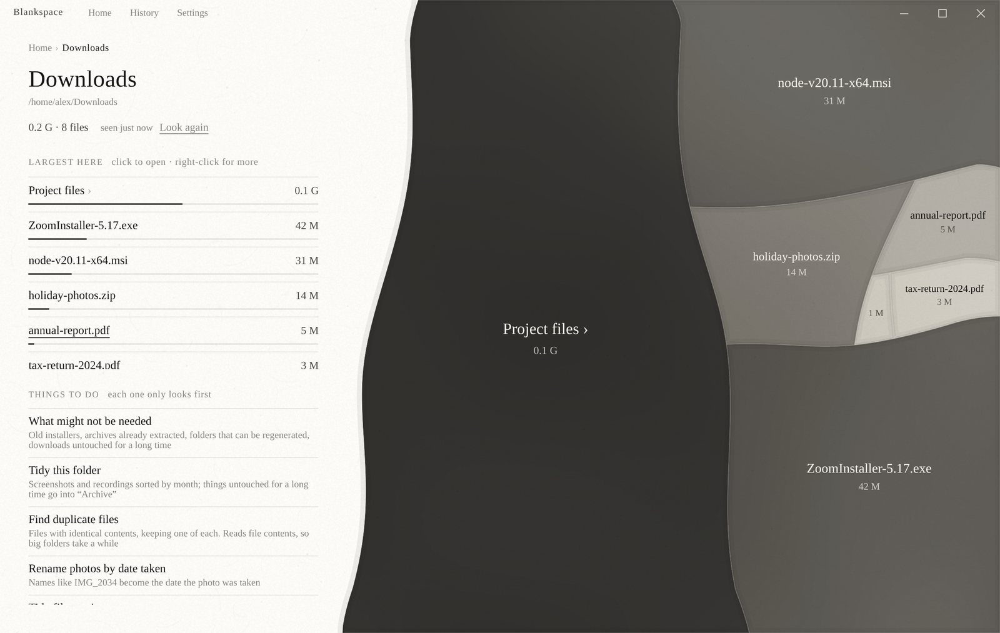
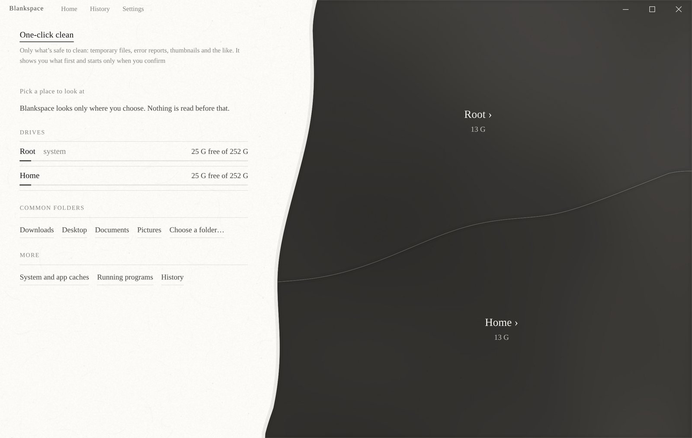
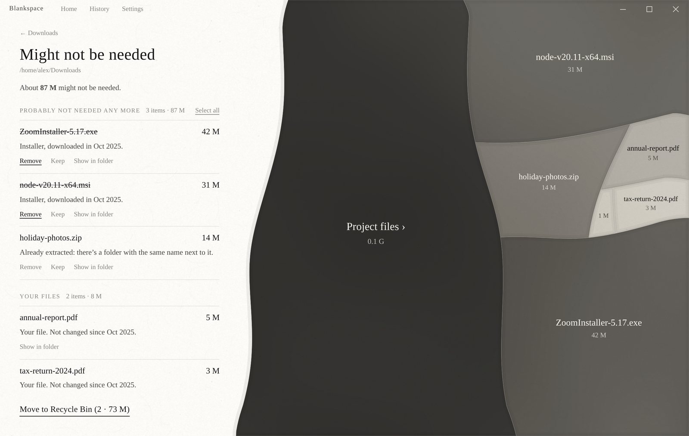
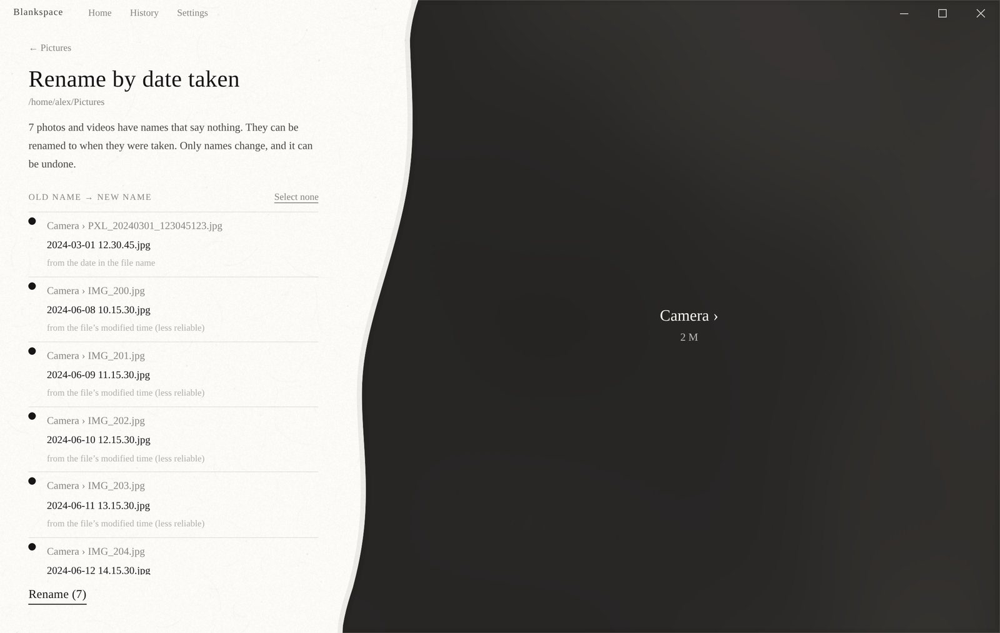
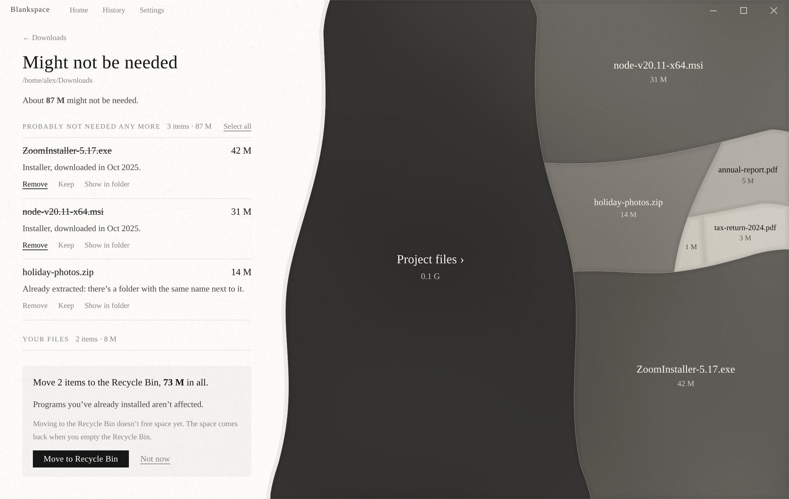
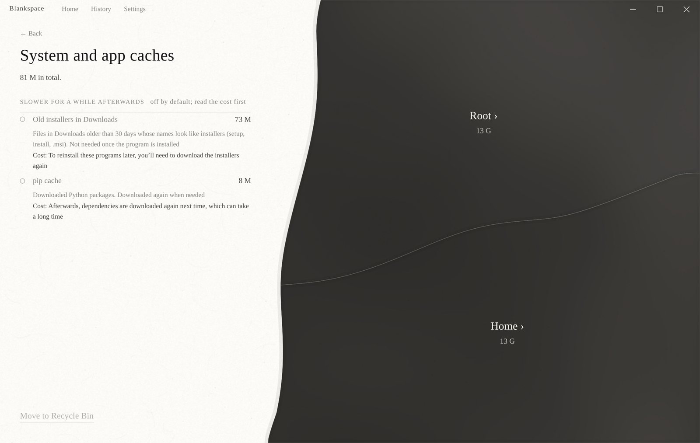
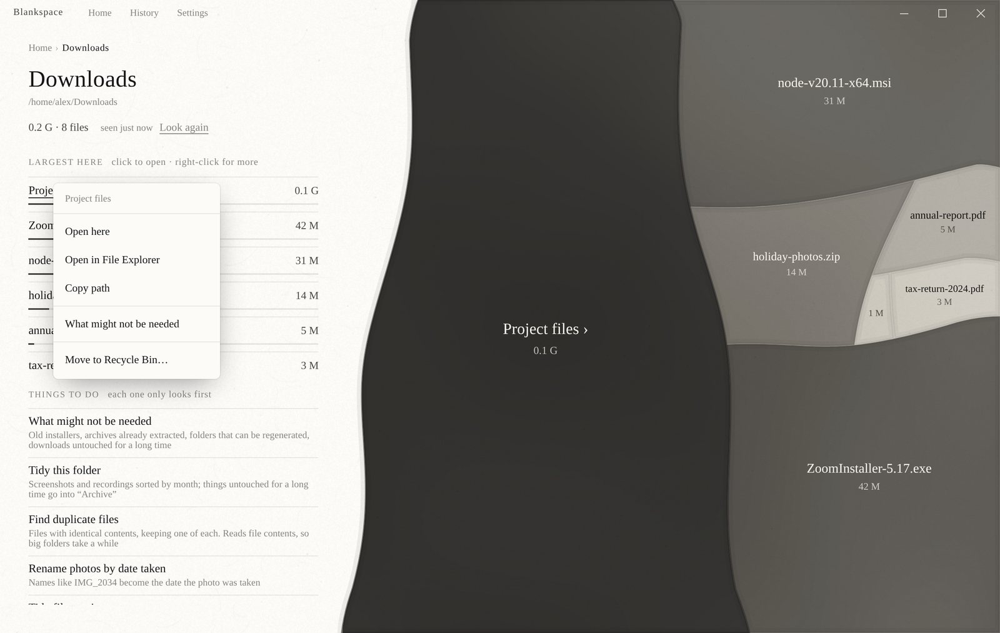

<p align="center">
  
</p>

<h1 align="center">Blankspace · 留白</h1>

<p align="center">
  A calm disk cleaner for Windows.<br>
  The whole window is a sheet of rice paper with ink on it: the darker the ink, the more space it takes;<br>the blank paper is your free space.
</p>

<p align="center">
  <a href="https://github.com/yunningtang/blankspace/releases/download/v0.7.0/Liubai-Setup-0.7.0.exe"></a>
  &nbsp;
  <a href="https://github.com/yunningtang/blankspace/releases/download/v0.7.0/Liubai-0.7.0-portable.zip"></a>
</p>

<p align="center">
  <a href="https://github.com/yunningtang/blankspace/releases/latest"></a>
  <a href="https://github.com/yunningtang/blankspace/releases"></a>
  <a href="https://github.com/yunningtang/blankspace/actions/workflows/windows.yml"></a>
</p>

<p align="center"><b>English</b> · <a href="README.md">中文</a></p>



## What it does

- **One-click clean**: cleans only what’s safe (temporary files, error reports, thumbnails, Blankspace’s own old records). It shows you exactly what first and starts only when you confirm.
- **Looks only where you choose**: nothing is scanned when it opens. Pick a drive (C, D, a USB drive) or a folder and it reads it slowly in the background. Places it has seen are remembered and shown straight away next time.
- **Walk into folders**: click a patch of ink to open that folder, and click any part of the path to go back. Right-click to open, show in folder, copy the path, move to the Recycle Bin or move to another drive.
- **File Explorer right-click**: right-click any folder or drive → “Look here with Blankspace”.
- **What might not be needed**: plain-language reasons for each suggestion: “already extracted”, “identical to the copy in Pictures”, “not changed since 2023”.
- **Caches**: the safe ones (temporary files and the like) are on by default. Browser and developer-tool caches are off by default, and each one says what clearing it costs. Caches of programs that are running are skipped.
- **Rename photos by date taken, tidy file versions**: IMG_2034 becomes “2023-05-04 14.22.10”; “final”, “final2” and “(1)” go into “Old versions”.
- **Running programs**: see what’s using your memory, and close a program that has hung.
- **Duplicates**: files with identical contents, one of each always kept, and you choose which.
- **Tidy Downloads and Desktop**: screenshots and recordings sorted by month; things untouched for a long time go into “Archive”. Files are moved, never removed.
- **Move to another drive**: videos you shot and things you wrote shouldn’t be deleted. Move them to drive D or a USB drive instead.
- **Undo anything**: moves and tidying go back in one click; things in the Recycle Bin can be restored from there.

| Pick a place | What might not be needed | Rename by date taken |
|---|---|---|
|  |  |  |

| Confirm before anything happens | Caches, with the cost spelled out | Right-click menu |
|---|---|---|
|  |  |  |

## What it won’t do

- **It never permanently deletes anything.** Removing always means moving to the Recycle Bin. Anything that can’t go there (USB sticks, network drives, files bigger than the Recycle Bin) is left alone.
- **It only looks by default.** It moves or removes files only after you turn on “Allow tidying and cleaning” in Settings.
- **It doesn’t decide for you.** Your own files are never selected by default, and every time it tells you what it will touch, and what it won’t, before it starts.
- **It stays out of Windows and your programs.** Windows, Program Files, program data and OneDrive are never touched.
- **It doesn’t empty the Recycle Bin.** Once emptied, things can’t be recovered, so that step is yours.
- **No network, no ads, no pop-ups.**

The full rules are in [Safety and flow](docs/安全与流程.md) (in Chinese).

## Download

| | File | Notes |
|---|---|---|
| **Installer** | [Liubai-Setup-0.7.0.exe](https://github.com/yunningtang/blankspace/releases/download/v0.7.0/Liubai-Setup-0.7.0.exe) | Double-click to install. No administrator rights needed; it installs into your own user folder. Optionally adds “Look here with Blankspace” to File Explorer’s right-click menu. |
| **Portable** | [Liubai-0.7.0-portable.zip](https://github.com/yunningtang/blankspace/releases/download/v0.7.0/Liubai-0.7.0-portable.zip) | Unzip and double-click `Liubai.exe`. Nothing is written to the registry. |

All versions and their SHA256 checksums are on the [Releases](https://github.com/yunningtang/blankspace/releases) page.

- Needs Windows 10 or 11 (64-bit) and Microsoft Edge WebView2 (built into Windows 11 and most Windows 10 PCs; if it’s missing, Blankspace tells you where to get it).
- The app follows your Windows display language (Chinese or English). Change it any time in Settings → Language.
- The program isn’t code-signed yet. If Windows says “Windows protected your PC” the first time, click “More info” → “Run anyway”.
- On Windows 11, “Look here with Blankspace” is under “Show more options” in the right-click menu.

## Run from source

Needs Windows 10 or 11 and [Python 3.10 or later](https://www.python.org/downloads/) (tick “Add python.exe to PATH” when installing).

In the project folder, open PowerShell:

```bash
python -m venv .venv
```

```bash
.venv\Scripts\activate
```

```bash
pip install -r requirements.txt
```

```bash
python main.py
```

## Development

- Tests: `python -m pytest tests`. Every test runs in temporary folders with a fake Recycle Bin, except a few that run only on the Windows CI machine and really move a test file to the Recycle Bin.
- English: the core logic speaks Chinese. `core/i18n.py` translates every result once at the interface boundary, and `tests/test_i18n.py` fails if any user-facing Chinese sentence has no English or if a full run in English leaves Chinese on screen. Interface text lives in `webui/app.js` as `L("中文", "English")`.
- Installers are built by GitHub Actions on Windows (`.github/workflows/windows.yml`): tests, PyInstaller, Inno Setup, then a real install / right-click menu check / uninstall before anything is published.

More (in Chinese): [User guide](docs/使用说明.md) · [Development](docs/开发说明.md) · [Changelog](CHANGELOG.md)
