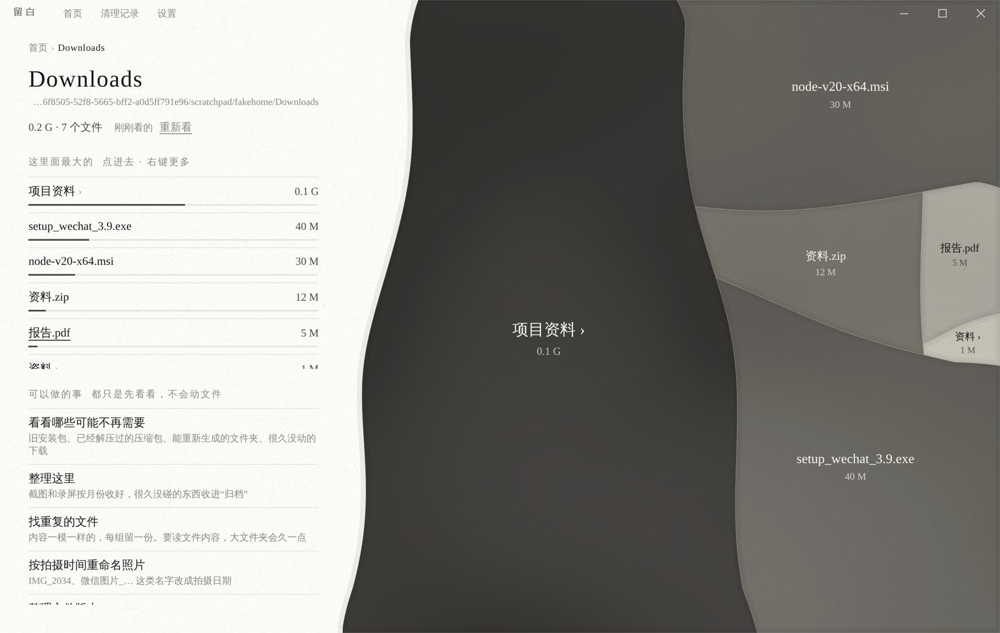
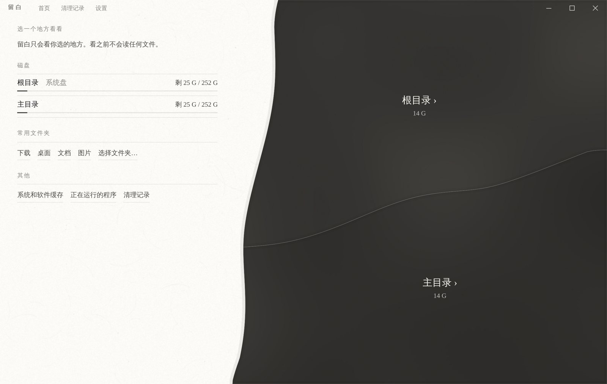
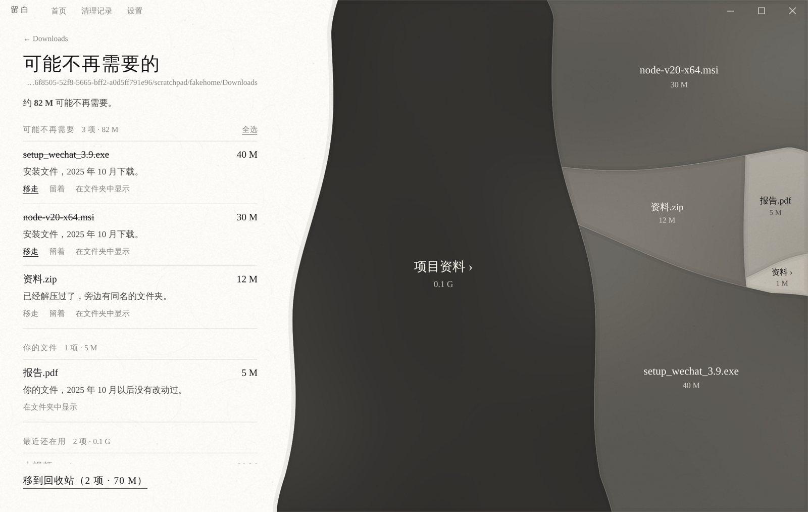
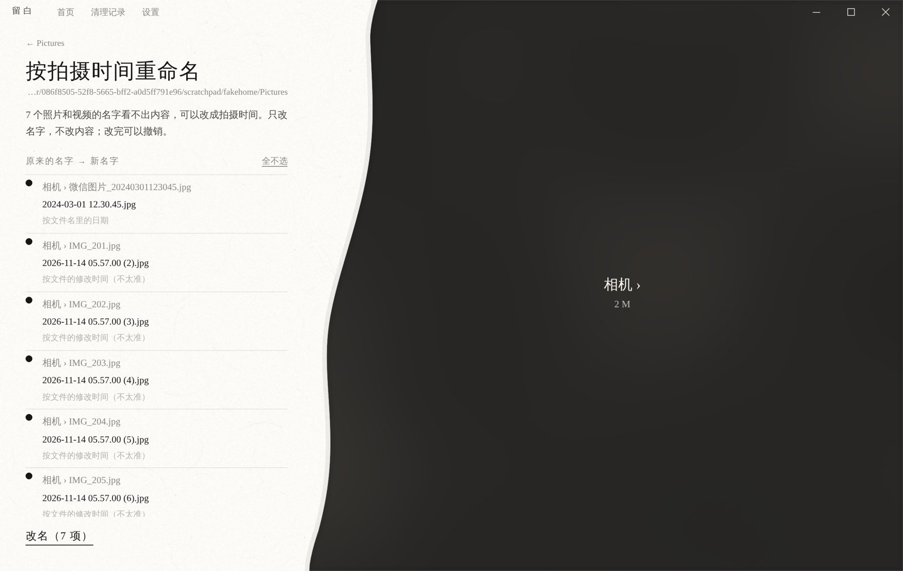

# 留白 · Blankspace

A calm disk cleaner for Windows — see where your space went, clean caches safely, tidy files, undo anything.

一个 Windows 上的磁盘清理和文件整理工具。整个窗口是一张宣纸上的水墨：墨越深，占的空间越大；空着的纸，就是你的可用空间。



## 它能做什么

- **你选了才看**：打开时不扫描任何东西。选一个盘（C、D、移动硬盘）或文件夹，它才在后台慢慢看；看过的地方记住，下次直接显示。
- **往里走**：点一块墨就进到那个文件夹，路径每一级都能点回去；右键可以打开、在文件夹中显示、复制路径、移到回收站、挪到别的盘。
- **资源管理器右键**：在任何文件夹或磁盘上右键“用留白看看这里”。
- **看看里面**：用人话告诉你哪些可能不再需要，以及为什么——“已经解压过了”“和图片里那份一模一样”“2023 年以后没有改动过”。
- **缓存**：临时文件这类可以放心清的默认选上；浏览器、开发工具的缓存默认不选，并写明清了的代价。正开着的程序的缓存不清。
- **照片按拍摄时间改名、整理文件版本**：IMG_2034 改成“2023-05-04 14.22.10”；“终版”“最终版”“(1)”收进“旧版本”。
- **正在运行的程序**：谁占了内存，一目了然；卡住的可以关掉。
- **重复文件**：找出内容一模一样的文件，每组只留一份，留哪一份可以改。
- **整理下载和桌面**：截图、录屏按月份收好，很久没碰的东西收进“归档”。只挪位置，不删除。
- **挪到别的盘**：自己拍的视频、写的东西，不建议删，可以挪到 D 盘或移动硬盘。
- **随时撤销**：挪走和整理的，一键放回原处；移到回收站的，在回收站里还原。

| 选一个地方 | 看看哪些可能不再需要 | 按拍摄时间重命名 |
|---|---|---|
|  |  |  |

## 它不会做什么

- **不会永久删除任何东西**。删除一律移到回收站；放不进回收站的（U 盘、网络盘、比回收站还大的文件），直接不动。
- **默认只看**。要在设置里打开“允许整理和清理”，才会动文件。
- **不会替你决定**。你的文件从不默认选中；每次动手前，都会原地告诉你要动什么、什么不会动。
- **不碰系统和程序**。Windows、Program Files、程序数据、OneDrive 里的文件一律不动。
- **不清空回收站**。清空了就找不回来，这一步留给你自己。
- **不联网，没有广告，没有弹窗。**

完整的规则见 [安全与流程](docs/安全与流程.md)。

## 下载

到 [Releases](https://github.com/yunningtang/blankspace/releases) 下载最新版：

- **Liubai-Setup-x.x.x.exe**：安装版，双击安装，不需要管理员权限。
- **Liubai-x.x.x-portable.zip**：便携版，解压后双击 `Liubai.exe`。

需要 Windows 10 或 11（64 位）。程序没有数字签名，第一次打开时如果 Windows 提示“已保护你的电脑”，点“更多信息”→“仍要运行”。

## 从源码运行

需要 Windows 10 或 11，以及 [Python 3.10 以上](https://www.python.org/downloads/)（安装时勾选 “Add python.exe to PATH”）。

在项目文件夹里打开 PowerShell：

```bash
python -m venv .venv
```

```bash
.venv\Scripts\activate
```

```bash
pip install -r requirements.txt
```

```bash
python main.py
```

> 第一次在自己的电脑上用之前，请先按 [安全与流程](docs/安全与流程.md) 最后的清单试一遍。

## 文档

- [使用说明](docs/使用说明.md)：每个界面怎么用、常见问题
- [安全与流程](docs/安全与流程.md)：删除和移动的每一条规则，以及在 Windows 上要确认的事项
- [开发说明](docs/开发说明.md)：代码结构、怎么测试、怎么打包
- [更新记录](CHANGELOG.md)

## 打包

安装程序由 GitHub Actions 在 Windows 上自动生成（`.github/workflows/windows.yml`）：每次推送都会先在 Windows 上跑全部测试，再打包；推送 `v` 开头的标签（比如 `v0.5.0`），或者手动运行时填上版本号，就会发布到 Releases，并附上 SHA256 校验值。

在自己的 Windows 电脑上打包：

```bash
pip install pyinstaller
```

```bash
pyinstaller --noconfirm packaging/liubai.spec
```

生成的程序在 `dist\Liubai\Liubai.exe`。再用 [Inno Setup](https://jrsoftware.org/isinfo.php) 编译 `packaging\installer.iss` 就得到安装程序。清理记录和设置保存在 `%LOCALAPPDATA%\Liubai\`。
